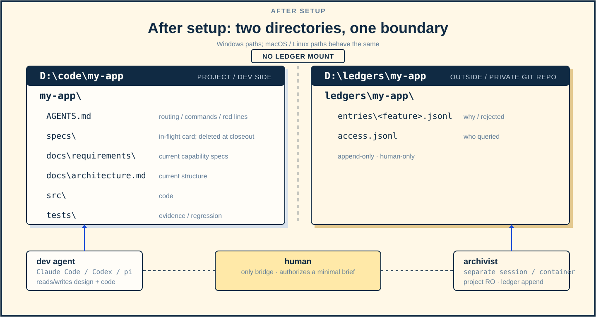

# Dev-circuit-ultra

Design is the source. History stays outside. A five-step feature loop for independent developers: one slice at a time, only the current design in the project.

<a href="LICENSE"></a>   

[After setup](#after-setup) · [Five steps](#five-steps) · [Quick start](#quick-start) · [Demo](#demo) · [Isolation](#isolation) · [How it differs from OpenSpec](#how-it-differs-from-openspec) · [Chinese](README.zh-CN.md)

Dev-circuit-ultra is a feature development loop for independent developers, delivered as a skill for coding agents such as Claude Code, Codex and pi. It breaks a feature into five steps: design clarification, one slice, build and verify, independent review, and closeout.

It does **not** maintain proposals, task lists or an archive, and it does not keep a long-lived design archive. **The current design is the only source.** When the design changes, the old text is overwritten or deleted; decision history lives in a private ledger **outside the project**, and the development agent never reads it.

## After setup

<p align="center"></p>

<p align="center"><em>Figure 1. The project and the private ledger are separate; the dev container has no ledger mount.</em></p>

`D:\code\my-app` is the project; `D:\ledgers\my-app` is a private git ledger outside it. The development agent only reads and writes the project; the archivist only appends to the ledger; the human is the only bridge.

- **Development side**: current design, capability specs, code and tests; no ledger mount, path or credentials.
- **Bookkeeping side**: project read-only, ledger append-only, in a separate session/container; nothing flows back.
- **Human**: when history is needed, query with `dev-circuit-ledger` and get a minimal brief; the raw ledger never enters the development context.

## Five steps

1. **Design clarification + intent card**: read the current product design; ask design questions; choose an approach; write the current design and spec delta.
2. **One slice**: plan only the next end-to-end slice; derive implementation/test scope from the design.
3. **Build + verify**: implement and test; change the design before changing code; run project checks.
4. **One independent review**: the implementation session dispatches a reviewer subagent with the current design, diff and base; one re-check at most.
5. **Accept + merge**: merge current requirements; delete the card/design; the human/orchestrator has the archivist record the final state outside the project.

## Quick start

```powershell
# 1. Sync the skill (Claude Code / agents directories)
pwsh -NoProfile -File sync.ps1

# 2. Create a project
pwsh -NoProfile -File skills/dev-circuit-ultra/scripts/new-project.ps1 `
  -Path D:\code\my-app -Name "My App"

# 3. Create the private ledger OUTSIDE the project
pwsh -NoProfile -File skills/dev-circuit-ultra/scripts/new-ledger.ps1 `
  -Path D:\ledgers\my-app
```

Then start with design clarification inside the project. The ledger is a separate step; no `ledger/` appears in the project.

Implementation: Markdown skill + Python 3 (`doc_guard` / `spec_check`) + PowerShell 7 (bootstrap) + git; no server component, Docker isolation optional.

## Demo

```powershell
python demo/run_demo.py
```

The demo creates a throwaway project and an external ledger. It exercises destructive design edits, discarded ideas living only in the ledger, card deletion at closeout, and `doc_guard` rejecting a project `ledger/` directory. It does not call an LLM; strong isolation is the Docker mount boundary. See [demo/README.md](demo/README.md).

## Isolation

A prompt that says "do not read the ledger" is **not** isolation. To guarantee it:

| Level | Setup | Guarantee |
|---|---|---|
| Weak | prompt convention | prevents accidental reads only |
| Medium | private repo outside the project; no path in project | prevents accidental reads, not a determined same-user process |
| **Strong** | separate containers/OS users; dev has no ledger mount or credentials | the dev process has no read permission |

Strong isolation is recommended. See [`docker/compose.yaml`](docker/compose.yaml):

- `dev`: project only; no `/ledger`; no ledger remote credentials; no Docker socket.
- `archivist`: project read-only + ledger writable; append-only; no product edits.
- `ledger`: ledger read-only; for human queries.
- The ledger remote must be private; credentials only in the archivist/human environment.

Full boundary and verification commands: [docs/ledger.md](docs/ledger.md) and [docker/README.md](docker/README.md).

## How it differs from OpenSpec

| | OpenSpec | Dev-circuit-ultra |
|---|---|---|
| Design | proposal/design/tasks/spec delta, kept over time | current design; overwrite/delete on change |
| Decision history | in change/archive, growing | external private ledger, human only |
| What the dev agent reads | potentially the whole history | current design/code only |
| Closeout | archive retained | card/design deleted; current state only |
| Goal | audit trail, cross-person handoff | fast iteration, lean context, no drift |

OpenSpec is a better fit when you need an audit trail, cross-person handoff or cross-repo planning. Dev-circuit-ultra is lighter for one developer shipping continuously with an agent.

## FAQ

**What if the design changes?**

Change the design first: overwrite/delete the old text; then code/tests. The archivist records the old decision and rejected options in the external ledger.

**What if the dev agent needs an old decision?**

Stop and ask the human. The human queries the ledger with `dev-circuit-ledger`, gets a minimal brief, and passes only the current constraints to the dev agent.

**Can the dev agent read the ledger?**

Not under strong isolation: no mount, no path, no credentials. Weak/medium setups are conventions, not guarantees.

**Why keep a design at all?**

The design is the implementation basis, not a history. Without it the agent guesses; the ledger explains past guesses to the human, not to the agent.

**How many tests?**

Enough to cover the design's boundaries/contracts. Tests are evidence, not a decision archive; disposable tests are fine, only user-visible contract/regression tests need to stay. No test matrix.

## Docs

- [SKILL.md](skills/dev-circuit-ultra/SKILL.md): full workflow, rules and templates
- [docs/ledger.md](docs/ledger.md): boundaries, isolation and verification commands
- [docker/README.md](docker/README.md): dev / archivist / ledger container reference
- [demo/README.md](demo/README.md): deterministic end-to-end demo
- [bench/README.md](bench/README.md): pre-rename spec-loop baseline; not a benchmark of the new workflow

## License

MIT
