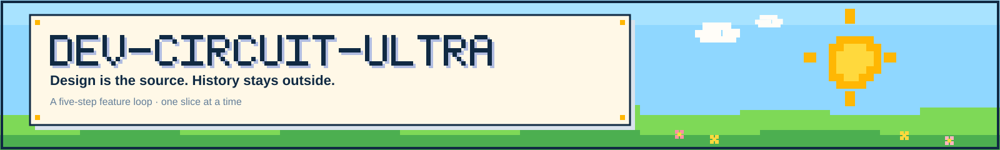

# Dev-circuit-ultra

Less context. Less ceremony. One feature at a time.

A design-first development flow for coding agents.

<a href="LICENSE"></a>   

[Flow](#flow) · [Quick start](#quick-start) · [Commands](#commands) · [Ledger](#ledger) · [How it differs from OpenSpec](#how-it-differs-from-openspec) · [Chinese](README.zh-CN.md)

Dev-circuit-ultra is a feature development flow for independent developers, delivered as a skill for coding agents such as Claude Code, Codex, pi and DeepSeek Harness, plus a `devcircuit` command-line tool.

It keeps no proposal, tasks or archive. **The design is the single current source**: capability specs and `docs/architecture.md` are overwritten in place; why things changed and which options were rejected go to a private ledger outside the project. The development agent writes the ledger but never reads it, and `devcircuit ledger check` keeps the two consistent.

## Flow

```text
request → ① Classify ─┬─ continue or correct a feature in progress ─────────→ ④
                      ├─ change an existing capability ─┐
                      ├─ new capability ────────────────┴─ four fit questions ─all yes─→ ③
                      │                                                       └any no → ② Framework design → ③
                      └─ bug → fast lane: fix + test, review when it qualifies
③ Feature design → ④ Build slices → ⑤ Review + one fix round → ⑥ Deliver
```

1. **Classify**: `devcircuit context --map` lists the capabilities, the features in progress and where the framework summary is. Decide whether the request continues a feature in progress, changes an existing capability, adds a new one or fixes a bug. New capabilities and capability changes go through four fit questions: who owns the data, do the current extension points and contracts suffice, is a new dependency or persistence structure needed, does it break a framework constraint.
2. **Framework design** (when the framework cannot take it): name the gap, offer two or three structures with trade-offs and a recommendation, and clarify until the user says it is settled. The structure goes into `docs/architecture.md`, which opens with a framework summary of at most 60 lines.
3. **Feature design**: send a design summary in the conversation (requirement changes with examples; every new command or interface gets at least one failure requirement). Nothing is written and no code changes until the user settles it. Then branch to `feat/<feature>`, edit the capability spec, write the card, and record the decision and the rejected options with `devcircuit ledger add`.
4. **Build**: each session starts with `devcircuit context --feature <feature>` and reads only the card, the requirement text this feature touches and the related tests. One end-to-end slice at a time; tests carry the requirement IDs they prove.
5. **Review + one fix round**: when the feature is done and before acceptance, a read-only reviewer in a fresh context reviews once and exercises the failure paths first. Must-fix items get one fix round and one re-check.
6. **Deliver**: after the user accepts, `devcircuit close` runs the checks, cross-checks the ledger, deletes the card, commits, and records the close. The final reply is the delivery report: what changed, how to verify, review result, potential issues, next steps.

The user takes part in three places only: framework clarification (when needed), feature clarification, and acceptance.

## Quick start

```bash
# 1. Install the CLI (the flow uses it; same on Windows / macOS / Linux)
pipx install git+https://github.com/iswalterwu/dev-circuit-ultra   # not on PyPI yet

# 2. Sync the skills into Claude Code / agents / DeepSeek Harness
devcircuit sync

# 3. New project (an existing repo takes --adopt and only fills the gaps)
devcircuit init --path ~/code/my-app --name "My App"

# 4. Create the private ledger outside the project and seal the boundary at the tool-call layer
devcircuit ledger init --path ~/ledgers/my-app
devcircuit hooks install --harness pi --project ~/code/my-app --ledger ~/ledgers/my-app
```

Then use the `dev-circuit-ultra` skill inside the project: bring a request, the agent classifies it, then goes to framework design or feature design.

To upgrade an older project, run `devcircuit migrate --check --project <project>` first. It lists what to change (old card sections, `design.md`, AGENTS.md routing, checker versions, ledger setup) and changes nothing; migrate the features in progress before syncing the new skill.

`sync.ps1`, `new-project.ps1` and `new-ledger.ps1` still work; they forward to the same implementation. Implementation: a Markdown skill + Python 3 (`devcircuit`, `doc_guard`, `spec_check`) + git; PowerShell 7 only for the forwarding scripts; no server component.

## Commands

| Command | What it does |
|---|---|
| `devcircuit context --map` | capabilities, features in progress, where the framework summary is, other docs, backlog size |
| `devcircuit context --capability <CODE>` / `--ids <ID,...>` | one capability's requirement list / the requirement text with examples |
| `devcircuit context --feature <name>` / `--review <name>` | the card, requirement text the branch changed or cites, related tests, what was left out; `--review` adds the base and a diff summary |
| `devcircuit ledger add` | append one ledger record; answers with a receipt only |
| `devcircuit ledger check` | cross-check ledger and project; reports features, IDs and commits that disagree, never record content |
| `devcircuit close <name>` | full checks → ledger check → delete the card and commit → close record → delivery report skeleton |
| `devcircuit check` / `doc-guard` / `spec-check` / `rules` | the two checkers |
| `devcircuit migrate --check` | before upgrading, list what an older project must change |
| `devcircuit init` / `vendor` / `sync` / `hooks install` / `ledger init` | create or adopt a project, refresh the checkers, sync the skills, install hooks, create the ledger |

## Two checkers

Both scripts are still single files you can copy into a project; the pre-commit hook and CI run them:

```bash
devcircuit check --root .                 # both checks, one exit code
devcircuit doc-guard --root .             # forbidden paths, history phrases, broken links, size limits, framework summary
devcircuit spec-check --root . --report   # requirement IDs, dangling references, card before code, test coverage
devcircuit rules                          # what every rule checks
```

- `doc_guard`: forbidden paths (`ledger/`, `docs/adr` and more), history phrases, decision IDs, hashes, broken links; capability specs over 400 lines, cards over 80 lines, a missing framework summary or one over 60 lines.
- `spec_check`: codes and IDs, duplicate IDs, dangling references in code and tests; on a `feat/<feature>` branch, code changes before the card exists are reported as `code-before-design`.
- `--ignore GLOB`, `.dcuignore`, `--ignore-rule NAME` and inline `doc-guard:ignore` / `off` / `on` whitelist false positives; `--include GLOB` scans extra `.md` files outside the default scope.
- Pure Python 3.10+, no dependencies; CI runs on Windows and Ubuntu.

They also work in repositories that do not use this flow:

```bash
devcircuit doc-guard --root ~/work/legacy-repo --ignore 'vendor/**' --ignore CHANGELOG.md
devcircuit spec-check --root ~/work/openspec-repo --ignore-rule dangling-ref
```

## Ledger

The ledger is a private git repo outside the project. It records the chosen decision, the rejected options and why. The development agent writes one record when a design is settled and one when it changes; `devcircuit close` writes the close record. That is usually two or three records per feature and no extra session. The agent gets a receipt, never the content. `devcircuit ledger check` compares both sides and reports missing close or design records, records pointing at commits the repo no longer has, and removed requirements with no recorded reason. Humans query the ledger with `dev-circuit-ledger` in a separate session.

A prompt that says "do not read the ledger" is **not** isolation. Four levels:

| Level | Setup | Guarantee |
|---|---|---|
| Weak | prompt convention | prevents accidental reads only |
| **Medium (default)** | `devcircuit hooks install`: block at the tool-call layer | the agent cannot reach the ledger; `ledger add` / `check` keep working |
| Strong | the ledger is owned by another OS user / an ACL the dev process lacks | no read permission for the dev process; records and checks run on the ledger side, by a human |
| Strongest | the dev container has no ledger mount or credentials | nothing to reach inside the process; same as above |

Details: [docs/ledger.md](docs/ledger.md), [hooks/README.md](hooks/README.md) and [docker/README.md](docker/README.md).

## DeepSeek Harness

The same repository is also a DSH plugin package and a set of DSH-compatible skills. The plugin registers both skills at once:

```powershell
dsh plugin --profile web add dev-circuit-ultra
```

Or publish the individual `skills/<name>/` folders to the Skill Store through SkillHub / ClawHub. `dev-circuit-ledger` is human-invoked only; the development model cannot auto-load it. See [docs/dsh.md](docs/dsh.md) for installation, store publishing and listing copy.

## Demo

```powershell
python demo/run_demo.py
```

The demo creates a throwaway project and an external ledger and walks one feature through the flow: a design commit on a branch, `ledger add`, a design change, `context --feature`, the build, `close`. It also checks that `doc_guard` rejects a project `ledger/` directory and that the hook blocks a ledger read while letting `ledger add` through. It does not call an LLM. See [demo/README.md](demo/README.md).

## How it differs from OpenSpec

| | OpenSpec | Dev-circuit-ultra |
|---|---|---|
| Design | proposal / design / tasks / spec delta, kept after archiving | capability specs and `docs/architecture.md` edited in place; the card is deleted at close |
| Decision history | in the change and the archive, inside the repo | private ledger outside the project; the agent writes but never reads it, `ledger check` keeps it consistent |
| What the agent reads | per-phase skill instructions and several files per change | current requirements and the card, fetched by ID through `devcircuit context` |
| Review | optional verify | one independent review per feature that exercises failure paths first; one fix round for must-fix items |
| Close | `openspec archive` merges the delta and archives | one `devcircuit close` command |
| Fits | audit trails, hand-offs between people, cross-repo planning | one person with an agent, one feature at a time |

## FAQ

**What happens when the design changes?**

Go back to feature design. Once the user settles it, update the capability spec or `docs/architecture.md` first (overwrite or delete the old text), then code and tests, and record the rejected old decision with `devcircuit ledger add --kind design-change`.

**What if the development agent needs an earlier design?**

It stops and asks the human. The human queries the ledger with `dev-circuit-ledger` and hands over only the current constraints from the brief, never the raw ledger.

**Can the development agent read the ledger?**

Not through tool calls: the hook blocks any tool argument that names the ledger path (or `guard.json`). `ledger add` answers with a receipt only and `ledger check` reports only features, IDs and commits. For a filesystem-level guarantee, use another OS user or a container without the ledger mount.

**Which model reviews?**

AGENTS.md has one "审核模型" (review model) line: the same model in a fresh context, or a named agent or model; without it, the current model reviews. The fast lane is reviewed only when a contract changes or the diff exceeds about 200 lines.

**How many tests?**

As many as the boundaries and contracts in the requirements need: core logic, contracts, state machines, migrations and security get tests first; at most one end-to-end test per key path. Test files carry the requirement IDs they prove, and `spec_check --report` lists the requirements with no test; no test matrix.

## Docs

- [SKILL.md](skills/dev-circuit-ultra/SKILL.md): the full flow and rules
- [docs/ledger.md](docs/ledger.md): current design vs. ledger, when to write, check rules, isolation levels
- [hooks/README.md](hooks/README.md): the four isolation levels and how the hook works
- [docker/README.md](docker/README.md): the strongest level, as a container reference
- [CHANGELOG.md](CHANGELOG.md): user-facing changes per version
- [docs/dsh.md](docs/dsh.md): DeepSeek Harness installation, compatibility and store publishing
- [demo/README.md](demo/README.md): the deterministic end-to-end demo

## License

MIT
