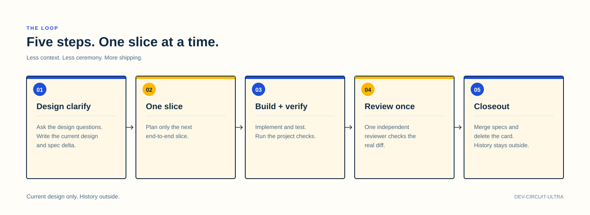
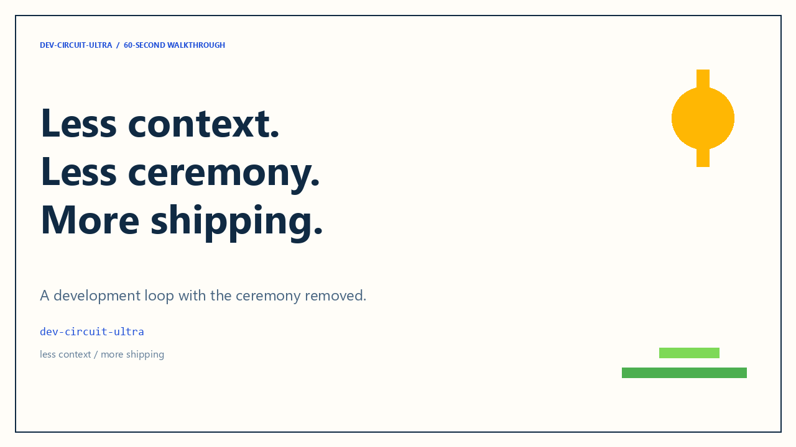
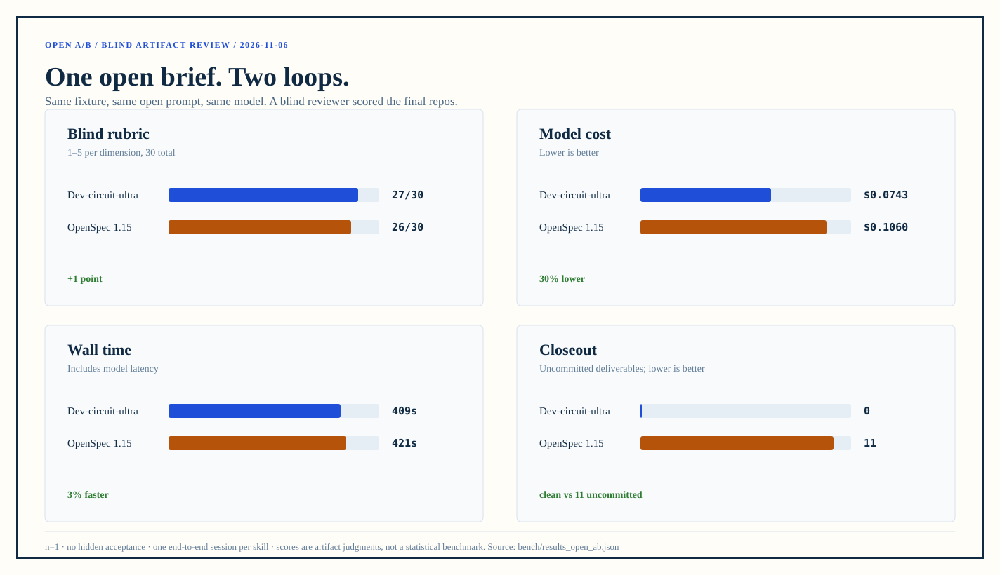

# Dev-circuit-ultra

Less context. Less ceremony. More shipping.

A design-first, five-step development loop for coding agents.

<a href="LICENSE"></a>   

[After setup](#after-setup) · [Five steps](#five-steps) · [Quick start](#quick-start) · [Demo](#demo) · [Isolation](#isolation) · [How it differs from OpenSpec](#how-it-differs-from-openspec) · [Chinese](README.zh-CN.md)

Dev-circuit-ultra is a feature development loop for independent developers, delivered as a skill for coding agents such as Claude Code, Codex, pi and DeepSeek Harness. It breaks a feature into five steps: design clarification, one slice, build and verify, independent review, and closeout.

It does **not** maintain proposals, task lists or an archive, and it does not keep a long-lived design archive. **The current design is the only source.** When the design changes, the old text is overwritten or deleted; decision history lives in a private ledger **outside the project**, and the development agent never reads it.

## After setup

<p align="center"></p>

<p align="center"><em>Figure 1. The project and the private ledger are separate; the dev container has no ledger mount.</em></p>

`D:\code\my-app` is the project; `D:\ledgers\my-app` is a private git ledger outside it. The development agent only reads and writes the project; the archivist only appends to the ledger; the human is the only bridge.

- **Development side**: current design, capability specs, code and tests; no ledger mount, path or credentials.
- **Bookkeeping side**: project read-only, ledger append-only, in a separate session/container; nothing flows back.
- **Human**: when history is needed, query with `dev-circuit-ledger` and get a minimal brief; the raw ledger never enters the development context.

## Five steps

<p align="center"></p>

<p align="center"><em>Figure 2. The five-step loop: current design in, history out.</em></p>

1. **Design clarification + intent card**: read the current product design; ask design questions; choose an approach; write the current design and spec delta.
2. **One slice**: plan only the next end-to-end slice; derive implementation/test scope from the design.
3. **Build + verify**: implement and test; change the design before changing code; run project checks.
4. **Independent review**: normal features get one final review; framework-level changes get one structural review before code plus one final review. The reviewer sees the current design, diff and base; one re-check at most.
5. **Accept + merge**: merge current requirements; delete the card/design; the human/orchestrator has the archivist record the final state outside the project.

## Quick start

```bash
# 1. Install the CLI (the only prerequisite; same on Windows, macOS and Linux)
pipx install git+https://github.com/iswalterwu/dev-circuit-ultra   # not on PyPI yet

# 2. Sync the skill into the Claude Code / agents / DeepSeek Harness directories
devcircuit sync

# 3. Create a project (--adopt fills the gaps in an existing repo)
devcircuit init --path ~/code/my-app --name "My App"

# 4. Create the private ledger OUTSIDE the project
devcircuit ledger --path ~/ledgers/my-app

# 5. Close the boundary at the tool-call layer
devcircuit hooks install --harness pi --project ~/code/my-app --ledger ~/ledgers/my-app
```

`sync.ps1`, `new-project.ps1` and `new-ledger.ps1` still work; they forward to the same implementation.

Then start with design clarification inside the project. On the first feature, the skill asks once how to run the independent review (same model, a named reviewer agent, or ask again each feature) and saves the choice in `.dev-circuit/reviewer.json`. The ledger is a separate step; no `ledger/` appears in the project.

Implementation: Markdown skill + Python 3 (`doc_guard` / `spec_check`) + PowerShell 7 (bootstrap) + git; no server component, Docker isolation optional.

## The checks

The two guards are single files you can copy into a project, and one command when you would rather install them:

```bash
devcircuit check --root .                 # doc + spec checks, one exit code
devcircuit doc-guard --root .             # forbidden paths, history phrases, broken links
devcircuit spec-check --root . --report   # requirement IDs, dangling refs, test coverage
devcircuit rules                          # rule names for --ignore-rule
```

They stay usable in repositories that never heard of this loop:

```bash
devcircuit doc-guard --root ~/work/legacy-repo --ignore 'vendor/**' --ignore CHANGELOG.md
devcircuit spec-check --root ~/work/openspec-repo --ignore-rule dangling-ref
```

- `--ignore GLOB` and a `.dcuignore` file (one glob per line) whitelist false positives; a glob without a slash matches any path segment. Both `/` and `\` work as separators, case is ignored on Windows and significant elsewhere, and there is no `!` negation.
- `--ignore-rule NAME` drops one rule; `devcircuit rules` lists them.
- Inline `doc-guard:ignore`, `doc-guard:off` / `doc-guard:on` suppress a line or a block.
- Code fences are not treated as document claims.
- Requirement definitions are recognised as `-`, `*`, `+`, `1.`, bold-prefixed or table rows; change entries accept English verbs (`add` / `modify` / `remove`) and sections accept `## Spec changes`.
- The guards are pure Python 3.10+ with no dependencies; CI runs both Windows and Ubuntu.

## DeepSeek Harness

The same repository is a DSH plugin package and a set of DSH-compatible skills. Install the package to register all three skills at once:

```powershell
dsh plugin --profile web add dev-circuit-ultra
```

Or publish the individual `skills/<name>/` folders to the Skill Store through SkillHub / ClawHub. `dev-circuit-archivist` and `dev-circuit-ledger` are human-invoked only; the development model cannot auto-load them. See [docs/dsh.md](docs/dsh.md) for installation, store publishing and listing copy.

## Demo

<p align="center"><a href="assets/demo-60s-en.webm"></a></p>

<p align="center"><em>60-second walkthrough: the five steps plus the open-ended OpenSpec A/B (WebM, no audio).</em></p>

```powershell
python demo/run_demo.py
```

The demo creates a throwaway project and an external ledger. It exercises destructive design edits, discarded ideas living only in the ledger, card deletion at closeout, and `doc_guard` rejecting a project `ledger/` directory. It does not call an LLM; strong isolation is the Docker mount boundary. See [demo/README.md](demo/README.md).

## Isolation

A prompt that says "do not read the ledger" is **not** isolation. Four levels, different costs and guarantees:

| Level | Setup | Guarantee |
|---|---|---|
| Weak | prompt convention | prevents accidental reads only |
| **Medium (default)** | `devcircuit hooks install`: block at the tool-call layer | the agent cannot get the ledger through a tool call; cross-platform, reviewable |
| Strong | the ledger is owned by another OS user / an ACL the dev process lacks | the dev process has no read permission |
| Strongest | separate containers; dev has no ledger mount or credentials | nothing to reach inside the process |

The hook lives in the project and reads `<project>/.dev-circuit/guard.json` (a machine-local path — keep it out of git):

```bash
devcircuit hooks install --harness pi --project ~/code/my-app --ledger ~/ledgers/my-app
devcircuit hooks status --project ~/code/my-app
```

It also denies reads of `guard.json` itself, because that file names the ledger.

What the hook cannot do: the dev process still runs as the same OS user, so a command that never names the ledger path can still walk the filesystem. For that guarantee go stronger. Details: [`hooks/README.md`](hooks/README.md).

Strongest level, reference topology in [`docker/compose.yaml`](docker/compose.yaml):

- `dev`: project only; no `/ledger`; no ledger remote credentials; no Docker socket.
- `archivist`: project read-only + ledger writable; append-only; no product edits.
- `ledger`: ledger read-only; for human queries.
- The ledger remote must be private; credentials only in the archivist/human environment.

Full boundary and verification commands: [docs/ledger.md](docs/ledger.md) and [hooks/README.md](hooks/README.md).

## How it differs from OpenSpec

| | OpenSpec | Dev-circuit-ultra |
|---|---|---|
| Design | proposal/design/tasks/spec delta, kept over time | current design; overwrite/delete on change |
| Decision history | in change/archive, growing | external private ledger, human only |
| What the dev agent reads | potentially the whole history | current design/code only |
| Closeout | archive retained | card/design deleted; current state only |
| Goal | audit trail, cross-person handoff | fast iteration, lean context, no drift |

OpenSpec is a better fit when you need an audit trail, cross-person handoff or cross-repo planning. Dev-circuit-ultra is lighter for one developer shipping continuously with an agent.

## Latest A/B: what it saved

One open brief, one session per skill, one blind review of the final repos. n=1; compare with the caveats, not as a general claim.

| Against OpenSpec | Dev-circuit-ultra | OpenSpec | Difference |
|---|---:|---:|---:|
| Blind rubric (30) | **27** | 26 | +1 |
| Wall time | **408.9 s** | 421.0 s | −12.1 s (−2.9%) |
| Model cost | **$0.0743** | $0.1060 | −$0.0317 (−29.9%) |
| Input + output tokens | **72,308** | 113,337 | −41,029 (−36.2%) |
| Cache-read tokens | **1,891,968** | 3,678,333 | −1,786,365 (−48.6%) |
| Assistant turns | **39** | 50 | −11 (−22%) |
| Retained docs | **2 files / 132 lines** | 3 files / 273 lines | −1 file / −141 lines (−51.6%) |
| Closeout | **1 commit, clean** | 0 commits, 11 uncommitted | clean vs unfinished |
| Project tests | 13 | **21** | narrower coverage (tradeoff) |

The doc count covers requirements + usage guide + the OpenSpec main spec; OpenSpec's proposal/design/tasks files are not included. The token figures are observed usage, not a provider-neutral bill. Dev's 1-point win comes mainly from clean closeout and Decimal totals; OpenSpec has stronger tests and error handling. See [bench/README.md](bench/README.md) for the full artifact review.

<p align="center"></p>

<p align="center"><em>Figure 3. Open A/B (n=1, blind artifact review): Dev 27/30, OpenSpec 26/30. Dev was 3% faster, 30% cheaper, and finished clean; OpenSpec had more tests and stronger error handling but left 11 uncommitted entries and a float total. Not a general claim. See <a href="bench/README.md">bench/README.md</a>.</em></p>

## FAQ

**What if the design changes?**

Change the design first: overwrite/delete the old text; then code/tests. The archivist records the old decision and rejected options in the external ledger.

**What if the dev agent needs an old decision?**

Stop and ask the human. The human queries the ledger with `dev-circuit-ledger`, gets a minimal brief, and passes only the current constraints to the dev agent.

**Can the dev agent read the ledger?**

Through a tool call, no: the hook from `devcircuit hooks install` blocks every tool input that names the ledger (or the guard config). For a filesystem-level guarantee, run the dev process under its own OS user or in a container with no ledger mount. A prompt convention alone guarantees nothing.

**Why keep a design at all?**

The design is the implementation basis, not a history. Without it the agent guesses; the ledger explains past guesses to the human, not to the agent.

**Who chooses the reviewer?**

You do. On the first feature the skill asks whether to use the same model in an independent context, a named read-only reviewer agent, or ask again at the start of every feature; it stores the answer in `.dev-circuit/reviewer.json`. There is no fixed reviewer model in the skill. If the configured agent is missing or fails, it stops and asks instead of silently substituting an implementation worker.

**How many tests?**

Enough to cover the design's boundaries/contracts. Tests are evidence, not a decision archive; disposable tests are fine, only user-visible contract/regression tests need to stay. No test matrix.

## Docs

- [SKILL.md](skills/dev-circuit-ultra/SKILL.md): full workflow, rules and templates
- [docs/ledger.md](docs/ledger.md): boundaries, isolation and verification commands
- [hooks/README.md](hooks/README.md): the four isolation levels and how the hooks work
- [docs/dsh.md](docs/dsh.md): DeepSeek Harness install, compatibility and Store publishing
- [docker/README.md](docker/README.md): the strongest level — dev / archivist / ledger containers
- [demo/README.md](demo/README.md): deterministic end-to-end demo
- [bench/README.md](bench/README.md): the latest open A/B, blind rubric and measured savings

## License

MIT
