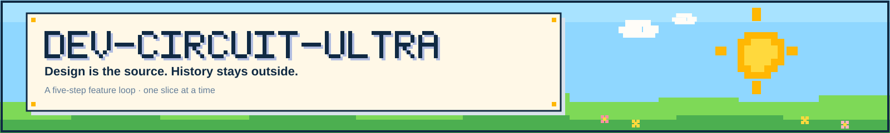
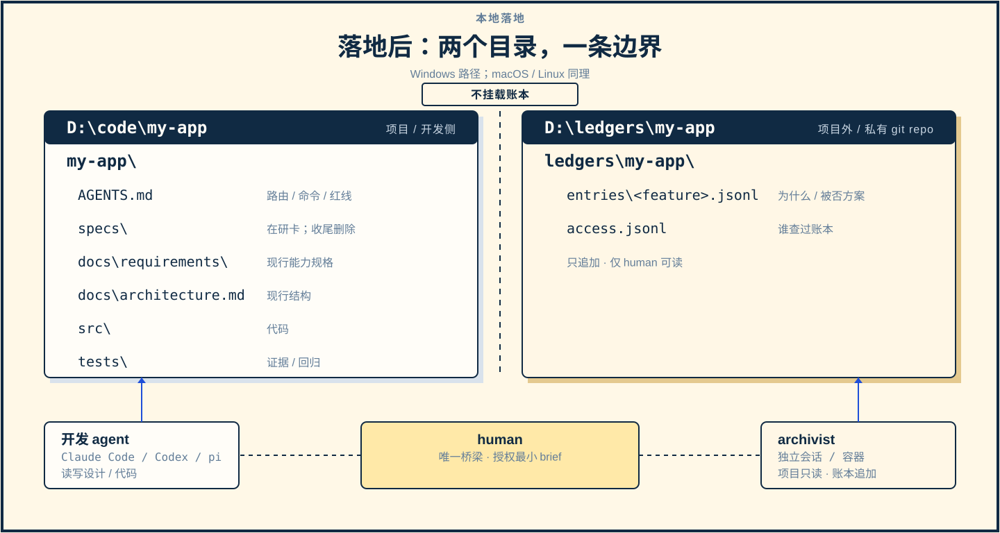
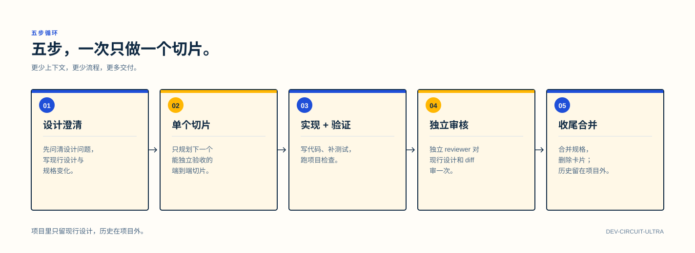
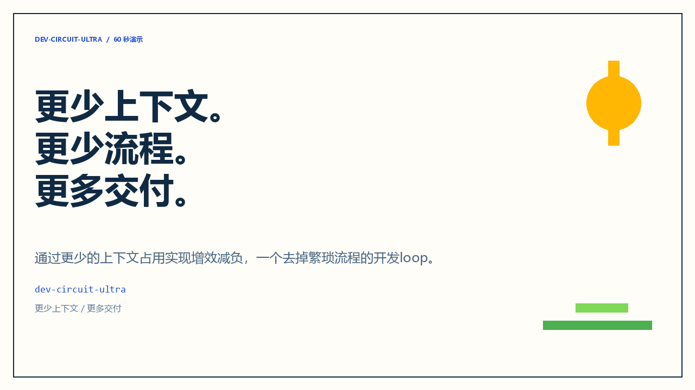
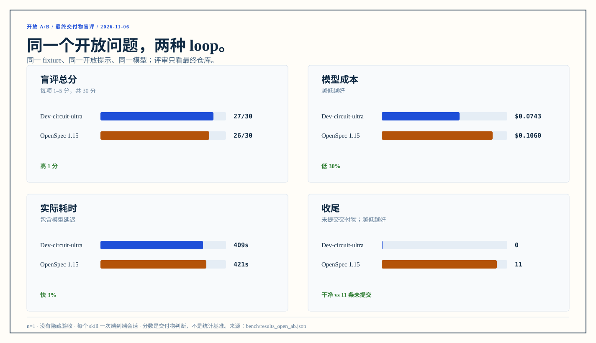

# Dev-circuit-ultra

通过更少的上下文占用实现增效减负，一个去掉繁琐流程的开发loop。

<a href="LICENSE"></a>   

[落地后](#落地后) · [五步](#五步循环) · [快速开始](#快速开始) · [Demo](#demo) · [强隔离](#强隔离) · [和 OpenSpec 的区别](#和-openspec-的区别) · [English](README.md)

Dev-circuit-ultra 是一套面向独立开发者的功能开发循环，以 skill 的形式加载到 Claude Code、Codex、pi、DeepSeek Harness 等编码 agent 中。它把功能开发拆成五步：设计澄清、单个切片、实现与验证、独立审核、收尾合并。

它不维护 proposal、tasks 或 archive，也不保留长期 design 档案。**设计是唯一现行源**；设计变更时原地覆盖或删除旧内容；决策历史写进项目之外的私有账本，开发 agent 不读。

## 落地后

<p align="center"></p>

<p align="center"><em>图 1：项目与私有账本分离；dev 容器不挂载账本。</em></p>

`D:\code\my-app` 是项目；`D:\ledgers\my-app` 是项目外的私有 git 账本。开发 agent 只读写项目，archivist 只追加账本，human 是唯一的桥。

- **开发侧**：现行设计、能力规格、代码、测试；没有账本挂载、路径或凭证。
- **记账侧**：项目只读、账本追加；独立会话/容器；不把账本内容回流。
- **human**：需要历史时，用 `dev-circuit-ledger` 查账本，生成最小 brief；原文不进开发上下文。

## 五步循环

<p align="center"></p>

<p align="center"><em>图 2：五步循环；项目里只留现行设计，历史在项目外。</em></p>

1. **设计澄清 + 意图卡**：读产品现行设计；问设计问题；选方案；写现行设计和规格变化。
2. **单个切片**：只规划下一个能独立验收的端到端切片；实现/测试范围从设计推导。
3. **实现 + 验证**：按设计写代码和测试；设计变了先改设计；跑提交前检查。
4. **独立审核一次**：实现会话派独立审核子 agent；只给现行设计、diff、基线；复查最多一次。
5. **验收 + 合并**：合并现行规格；删除卡/design；由 human/orchestrator 在项目外让 archivist 记录最终状态。

## 快速开始

```powershell
# 1. 同步 skill（Claude Code / agents / DeepSeek Harness 目录）
pwsh -NoProfile -File sync.ps1

# 2. 新建项目
pwsh -NoProfile -File skills/dev-circuit-ultra/scripts/new-project.ps1 `
  -Path D:\code\my-app -Name "My App"

# 3. 在项目外创建私有账本（不要放进项目）
pwsh -NoProfile -File skills/dev-circuit-ultra/scripts/new-ledger.ps1 `
  -Path D:\ledgers\my-app
```

然后在项目里用 `dev-circuit-ultra` skill 开始设计澄清。第一次做功能时，skill 会先问一次独立审核怎么做（同模型、指定 reviewer agent，或每个功能再问），并把选择写进 `.dev-circuit/reviewer.json`。账本初始化是单独一步，项目里不会出现 `ledger/`。

实现：Markdown skill + Python 3（`doc_guard` / `spec_check`）+ PowerShell 7（初始化）+ git；没有服务端组件，强隔离可选 Docker。

## DeepSeek Harness

同一个仓库也是 DSH 插件包和一组 DSH 兼容 skill。装插件可一次注册三个 skill：

```powershell
dsh plugin --profile web add dev-circuit-ultra
```

也可以把 `skills/<name>/` 分别通过 SkillHub / ClawHub 发布到 Skill Store。`dev-circuit-archivist` 和 `dev-circuit-ledger` 只由 human 显式调用，开发模型不会自动加载；安装、发布和文案见 [docs/dsh.md](docs/dsh.md)。

## Demo

<p align="center"><a href="assets/demo-60s-zh.webm"></a></p>

<p align="center"><em>60 秒演示：五步循环 + 与 OpenSpec 的开放 A/B（WebM，无配音）。</em></p>

```powershell
python demo/run_demo.py
```

demo 在临时目录里建一个项目和一个项目外的账本，演示：设计变更原地覆盖、被否方案只进账本、收尾删除卡片、`doc_guard` 拒绝项目内的 `ledger/`。它不调用 LLM；强隔离由 Docker 的挂载边界保证。详见 [demo/README.md](demo/README.md)。

## 强隔离

只在 prompt 里写“不要读账本”**不算隔离**。要保证开发 agent 读不到，至少做到：

| 级别 | 做法 | 能保证什么 |
|---|---|---|
| 弱 | prompt 约定 | 只能防误读 |
| 中 | 账本放独立私有 repo，项目里不写路径 | 防误读，不防同用户翻找 |
| **强** | dev / archivist 分容器或分 OS 用户；dev 不挂载账本、无凭证 | 开发进程没有读权限 |

推荐强隔离。参考 [`docker/compose.yaml`](docker/compose.yaml)：

- `dev`：只挂项目；没有 `/ledger`；没有账本 remote 凭证；没有 Docker socket。
- `archivist`：项目只读 + 账本读写；只追加，不改项目。
- `ledger`：账本只读；供 human 查询。
- 账本 remote 必须私有；凭证只在 archivist/human 环境。

完整边界和验证命令见 [docs/ledger.md](docs/ledger.md) 与 [docker/README.md](docker/README.md)。

## 和 OpenSpec 的区别

| | OpenSpec | Dev-circuit-ultra |
|---|---|---|
| 设计 | proposal/design/tasks/spec delta，长期保留 | 现行设计；变更时覆盖/删除 |
| 决策历史 | 写进 change/archive，越积越多 | 项目外私有账本，human only |
| 开发 agent 读什么 | 可能读到整套历史 | 只读现行设计/代码 |
| 收尾 | archive 保留 | 删除卡/design，只留现行 |
| 目标 | 审计轨迹、跨人交接 | 快速迭代、上下文精简、防漂移 |

需要审计轨迹、跨人交接、跨仓库规划时，OpenSpec 这类流程更合适；一个人带 agent 快速迭代时，Dev-circuit-ultra 更轻。

## 最新 A/B：省在哪

同一个开放任务、每个 skill 一个会话、最终交付物盲评。n=1；看差异和限制，不要当成普遍结论。

| 相对 OpenSpec | Dev-circuit-ultra | OpenSpec | 差异 |
|---|---:|---:|---:|
| 盲评总分（30） | **27** | 26 | +1 |
| 墙钟时间 | **408.9 s** | 421.0 s | −12.1 s（−2.9%） |
| 模型成本 | **$0.0743** | $0.1060 | −$0.0317（−29.9%） |
| 输入 + 输出 tokens | **72,308** | 113,337 | −41,029（−36.2%） |
| 缓存读取 tokens | **1,891,968** | 3,678,333 | −1,786,365（−48.6%） |
| assistant 轮次 | **39** | 50 | −11（−22%） |
| 留存文档 | **2 个文件 / 132 行** | 3 个文件 / 273 行 | −1 个 / −141 行（−51.6%） |
| 收尾 | **1 个提交，干净** | 0 个提交，11 条未提交 | 收尾 vs 未收尾 |
| 项目测试 | 13 | **21** | 覆盖更窄（代价） |

文档只计需求 + 使用说明 + OpenSpec 主规格，没计 OpenSpec 的 proposal/design/tasks。token 是实际观测用量，不是跨 provider 可比的账单。Dev 高 1 分主要来自干净收尾和 Decimal 合计；OpenSpec 的测试和错误处理更强。完整盲评见 [bench/README.md](bench/README.md)。

<p align="center"></p>

<p align="center"><em>图 3：开放 A/B（n=1，最终交付物盲评）：Dev 27/30，OpenSpec 26/30。Dev 快 3%、成本低 30%，收尾干净；OpenSpec 测试更多、错误处理更完整，但留下 11 条未提交，且合计有浮点误差。不是普遍结论。细节见 <a href="bench/README.md">bench/README.md</a>。</em></p>

## 常见问题

**设计变了怎么办？**

先改设计：原地覆盖/删除旧内容；再改代码/测试。旧决定和被否方案由 archivist 写进项目外账本，不留在设计里。

**开发 agent 需要以前的设计怎么办？**

停下来问 human。human 用 `dev-circuit-ledger` 查账本，生成最小 brief；只把 brief 里的现行约束交给开发 agent，不给账本原文。

**账本会不会被开发 agent 读到？**

强隔离下不会：dev 容器没有账本挂载、没有路径、没有凭证。弱/中隔离只是约定，不是保证。

**为什么还要写设计？**

设计是实现的依据，不是历史。没有现行设计，agent 只能猜；有了账本，猜错的原因可以回溯，但不需要把历史塞进上下文。

**reviewer 由谁定？**

由你定。第一次做功能时，skill 会问：用同模型的独立上下文、指定一个只读 reviewer agent，还是每个功能开始时再问；选择写进 `.dev-circuit/reviewer.json`。skill 里没有固定 reviewer 模型。配置的 agent 不存在或调用失败时，它会停下问你，不会静默换实现 worker。

**测试要写多少？**

由设计里的边界/契约决定；测试是证据，不是决策档案。测试可以是一次性的；只有用户可见契约/回归值得长期保留。不写 test matrix。

## 文档

- [SKILL.md](skills/dev-circuit-ultra/SKILL.md)：完整流程、规则和模板说明
- [docs/ledger.md](docs/ledger.md)：两条边界、强隔离和验证命令
- [docs/dsh.md](docs/dsh.md)：DeepSeek Harness 安装、兼容性与 Store 发布
- [docker/README.md](docker/README.md)：dev / archivist / ledger 容器参考
- [demo/README.md](demo/README.md)：确定性的端到端演示
- [bench/README.md](bench/README.md)：最新开放 A/B、盲评和节省数据

## 许可

MIT
