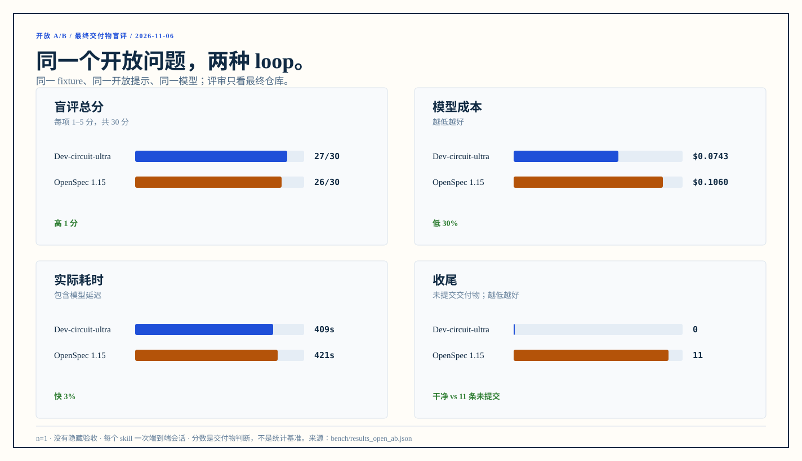

# Dev-circuit-ultra vs OpenSpec：开放问题 A/B

> 运行日期：2026-11-06。同一个 fixture、同一个开放提示、同一个模型；两个 skill 各跑一次端到端会话，然后由盲评者只看最终交付物打分。n=1，不是统计基准，也不是普遍质量结论。

这次没有 20 条验收、没有“2–3 个切片”、没有审核轮次/输出预算、没有指定命令形状，也没有隐藏验收。两个 skill 拿到同一段开放任务，自己决定设计、实现、测试和收尾。

## 结果

| | Dev-circuit-ultra | OpenSpec 1.15 |
|---|---:|---:|
| 盲评总分（30） | **27** | 26 |
| 模型成本 | **$0.0743** | $0.1060 |
| 墙钟时间 | **408.9 s** | 421.0 s |
| 会话 / assistant 轮次 | 1 / 39 | 1 / 50 |
| 项目测试 | 13 passed | **21 passed** |
| 现行要求行数 | 55 | 50 |
| 使用说明行数 | 77 | 114 |
| OpenSpec 主规格行数 | 0 | 109 |
| 留存文档合计 | 132 | 273 |
| 提交 | **1 个提交，无未提交交付物** | 0 个提交，11 条未提交 |
| 原有 `export --id 1` | 通过 | 通过 |
| 隐藏验收 | 未使用 | 未使用 |

读法：

- **Dev 最终得分高 1 分**，主要来自干净收尾、Decimal 金额合计和更短的使用说明；但测试只有 13 条，数据文件缺失、坏 JSON、输出不可写等错误路径会抛 traceback。
- **OpenSpec 的测试和错误处理明显更强**（21 条测试，缺失文件/坏 JSON/非 UTF-8/非法结构/不可写输出都退出 2），文档也更完整；但最终交付没有提交，且金额合计用 float，`0.1+0.2` 会输出 `0.30000000000000004`。
- **两边功能面相同**：查看、筛选、排序、合计、table/CSV/JSON、`-o`、`--data` 都有。
- **这次不是“Dev 全面更好”**：它是“更干净、更便宜、稍快，但测试/错误路径更少”；OpenSpec 是“更健壮、更完整，但没有收尾”。

<p align="center"></p>

## 开放问题

见 [open/problem.md](open/problem.md)：给 records 加一个团队每周费用复盘真正能用的报告能力，命令、参数、输出和文档结构由 agent 自己定。

起点相同：

- 4 条记录的 Python CLI，数据在 `records.json`；已有 `export --id N`。
- 同一个 `new-project` 骨架、同一个 fixture、同一份中性 [AGENTS.md](open/AGENTS.md)。
- OpenSpec 仓库额外执行了 `openspec init --tools pi`，否则它的 skill 没有可用的工作区；Dev 仓库使用骨架自带的 `docs/`、`scripts/`、`specs/`。
- Dev 项目的 `.dev-circuit/reviewer.json` 预置为用户选择的 `reviewer-fast`，因为 benchmark 非交互；真实用户第一次使用时由 skill 询问并保存，见 SKILL §1.2。
- 没有项目外账本参与 Dev 侧，所以账本成本不在表内。

## 怎么跑

每个 skill 只给一次提示，不拆成固定阶段：

```text
先读 AGENTS.md，再按你可用的 <workflow> 完成开放任务。
不要照抄固定步骤；由你决定怎么设计、怎么切片、是否审核、怎么收尾。
这是开放题，不是验收清单；不要问我问题，需要拍板就写假设。
```

完整提示见 [open/prompt.md](open/prompt.md)。两个仓库都从 `bench-base` 重置；每边只跑一个 `pi -p` 会话，给足 3600 秒；没有额外的 review/fix 轮次。

## 评估

评审规则见 [open/rubric.md](open/rubric.md)。评审者拿到去掉 `.git`、`.bench`、`.dev-circuit` 的 A/B 副本，只看最终代码、测试和文档；`EVIDENCE.md` 提供真实仓库的提交/未提交状态。评审不知道哪边是哪个 skill，打分后再记录映射。

| 维度 | Dev | OpenSpec |
|---|---:|---:|
| 产品用途 | 5 | 5 |
| 正确性 | 4 | 4 |
| 测试 | 4 | **5** |
| 设计与文档 | 4 | **5** |
| 代码质量 | **5** | 4 |
| 收尾 | **5** | 3 |
| **总分** | **27** | 26 |

完整评语见 [open/judge-result.md](open/judge-result.md)。评审是 LLM 盲评，不是人类评审；分数有主观性，但评语给出了可复现的命令和文件证据。

## 修改后的 Dev trace

这次先按旧 trace 的问题改了 skill，再重跑：

| 指标 | 修改前 | 修改后 |
|---|---:|---:|
| 总墙钟 | 1346.0 s | **408.9 s** |
| subagent | 804.1 s（5 次） | **107.0 s（2 次）** |
| 主模型 | 408.5 s | 269.5 s |
| assistant turns | 68 | 39 |
| 测试 | 22 | 13 |

修改点：

- 普通功能不再判 framework-level，取消写代码前结构审；
- 普通功能只在收尾后、最终提交前审一次；复查只审修复 diff；
- reviewer 由用户配置；本次用 `reviewer-fast`（继承当前模型），不再回退到错误的 `openai/gpt-6-astra`；
- 全量检查不再每个切片重复。

代价是测试面变窄；详见 [open/dev-trace-after.md](open/dev-trace-after.md)。旧 trace 的拆解在 [open/dev-trace.md](open/dev-trace.md)。

## 限制

- **n=1。** 一次运行不能代表两个 skill 的平均水平；模型状态、提示理解和实现选择都有方差。
- **一个会话不等于真实使用。** Dev-circuit-ultra 通常由 human 做设计澄清；OpenSpec 也常有人类 plan review。这次为了控制变量，禁止提问，并要求 agent 自己写假设。
- **评审是 LLM，不是人类。** 它可能偏好文档结构或提交状态；分数用于比较，不作为质量认证。
- **OpenSpec 侧没有完成归档/提交。** 这是最终状态的一部分：0 个提交、11 条未提交，收尾项因此得 3/5。
- **Dev 侧没有跑 archivist/外部账本。** 这个 benchmark 测的是项目内交付；真实流程中账本在项目外，另有成本。
- **没有隐藏验收。** 两边都保留了原有 `export`，但 Dev 的错误路径 bug 仍存在；OpenSpec 的 float 合计问题也仍存在。
- **commit 状态来自 EVIDENCE。** A/B 副本去掉了 `.git`，评审看到的是真实仓库的状态摘要，不是本地可复核的 git 历史。

## 复现

需要 Windows、PowerShell 7、Python 3、Node 22、pi、OpenSpec 1.15。

```powershell
# 把一个轻量、只读、继承当前模型的 reviewer 安装到 pi 用户目录
copy bench/open/reviewer-fast.md $HOME\.pi\agent\agents\reviewer-fast.md

# Dev 起点
pwsh -NoProfile -File <repo>/skills/dev-circuit-ultra/scripts/new-project.ps1 `
  -Path <ab>/dev-circuit -Name records
cp -r bench/fixture/. <ab>/dev-circuit/
cp bench/open/AGENTS.md <ab>/dev-circuit/AGENTS.md
mkdir <ab>/dev-circuit/.dev-circuit
'{"mode":"agent","agent":"reviewer-fast"}' | Set-Content <ab>/dev-circuit/.dev-circuit/reviewer.json
git -C <ab>/dev-circuit add -A
git -C <ab>/dev-circuit commit -m "chore: add records fixture and reviewer default"
git -C <ab>/dev-circuit tag bench-base

# OpenSpec 起点
pwsh -NoProfile -File <repo>/skills/dev-circuit-ultra/scripts/new-project.ps1 `
  -Path <ab>/openspec -Name records
cp -r bench/fixture/. <ab>/openspec/
cp bench/open/AGENTS.md <ab>/openspec/AGENTS.md
cd <ab>/openspec
git add -A
git commit -q -m "chore: add records fixture"
openspec init --tools pi --language zh-CN --no-animation --no-copilot-cloud
git add -A
git commit --no-verify -m "chore: init openspec"
git tag bench-base

# 两个开放会话
python bench/open/run_open_ab.py --root <ab>

# 生成图表
python bench/make_ab_chart.py
```

`run_open_ab.py` 的根路径目前是 `C:/Users/iswal/open-ab`；换机器时改脚本里的 `ROOT`。原始会话与评测副本在 `bench/out/open/`（不提交）；汇总结论见 [results_open_ab.json](results_open_ab.json)。

> 为什么 OpenSpec 的初始化提交用了 `--no-verify`：骨架的 `doc_guard` 会把 `openspec/changes/archive/` 当作禁止目录，这是 Dev-circuit-ultra 的规则，不适用于 OpenSpec 仓库。这个 hook 在 OpenSpec 侧不是被测对象。

## 旧基线

- [constrained.md](constrained.md)：2026-11-06 的受控 A/B，带 20 条验收、固定切片和审核预算；保留作历史。
- [pre-rename.md](pre-rename.md)：改名前的 spec-loop 基线；保留作历史。
