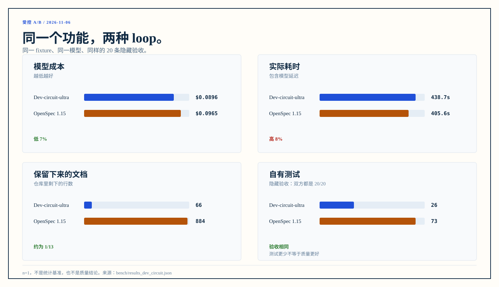

> 这是旧版的受控 A/B，保留作历史；主对比见 [README.md](README.md)。

# Dev-circuit-ultra vs OpenSpec：受控 A/B

> 运行日期：2026-11-06。同一个 fixture、同一个功能、同一个模型、同样的 20 条隐藏验收。n=1，不是统计基准，也不是质量结论。

这组数据比较的是**开发循环**，不是功能多少：两边都完成 `add-report`，都通过 20 条隐藏验收；差别在过程、留存文档和成本。

## 结果

| | Dev-circuit-ultra | OpenSpec 1.15 |
|---|---:|---:|
| agent 会话 | 3（实现 / 审核 / 收尾） | 5（提案 / 实现 / 审核 / 修复 / 归档） |
| 模型成本 | **$0.0896** | $0.0965 |
| 墙钟时间 | 438.7 s | **405.6 s** |
| 输入 / 输出 token | 59,255 / 54,421 | 101,856 / 49,357 |
| 缓存读 token | 1,091,840 | 1,115,008 |
| 留存文档 | **66 行**现行规格 | 884 行（353 行现行规格 + 531 行归档） |
| 自有测试 | 26 | 73 |
| 隐藏验收 | **20/20** | **20/20** |
| 提交 | 3 | 1 |

读法：

- **成本低 7%，不是数量级差异。** $0.0896 vs $0.0965；在这个任务上，两边都在 $0.1 以内。
- **时间高 8%。** 438.7 s vs 405.6 s；Dev-circuit-ultra 的审核和收尾并不更快。
- **留存文档只有 1/13。** 66 行 vs 884 行；OpenSpec 保留了归档，Dev-circuit-ultra 只留现行能力规格。
- **测试少 2.8 倍，但隐藏验收相同。** 26 vs 73；这不是“测试更少所以更好”，只是两边的测试面不同。两边都通过了同样的 20 条隐藏验收，不能据此推断质量相同。
- **审核并不更便宜。** Dev-circuit-ultra 审核 95.5 s / $0.0232，OpenSpec 审核 80.1 s / $0.0203；Dev 的审核输出更多（14,047 vs 10,422），抓到的问题数也不同。

<p align="center"></p>

## 怎么测的

### 起点

- 4 条记录的 Python CLI，数据在 `records.json`；已有 `export --id N`。
- 需求见 [feature.md](feature.md)：加 `report` 命令，20 条验收，覆盖表格、CSV、JSON、排序、过滤、分页、列选择、合计、错误处理和旧命令兼容。
- 隐藏验收见 [hidden/test_report.py](hidden/test_report.py)：20 条，agent 看不到。
- 两边都从同一个 fixture 和 `bench-base` 标签开始。

### 两个流程

**Dev-circuit-ultra**

1. `new-project.ps1` 生成项目骨架，放进 fixture，提交为 `bench-base`。
2. 会话 1：读 skill 和 AGENTS；写 `specs/add-report/spec.md`，包含 `## 设计` 和规格变化；在本会话内完成 2–3 个切片；跑 `pytest`、`doc_guard`、`spec_check`；不合并、不提交。
3. 会话 2：新会话独立审核全部切片；基线 `bench-base`；用 `reviewer.md` 的常规审核模式。
4. 会话 3：处理“必须改”，合并规格到 `docs/requirements/report.md`，提交，删卡，提交 `close add-report`。

**OpenSpec 1.15 受控完整流程**

1. `openspec init --tools pi`，放进 fixture，提交为 `bench-base`。
2. 会话 1：`openspec-propose`，生成 proposal、规格 delta、设计、任务。
3. 会话 2：`openspec-apply-change`，实现任务并跑测试。
4. 会话 3：独立审核，读 change 的 proposal/spec/design/tasks 和 `git diff bench-base`；用同一份 `reviewer.md` 标准。
5. 会话 4：处理必须改，补测试，跑 `pytest` 和 `openspec validate`，提交。
6. 会话 5：`openspec-archive-change`，检查 artifact/task，sync delta specs 到主规格，归档，提交。

### 统计

- 会话：`pi -p`，每次独立 `--session-dir`，从 session JSONL 汇总 token 和成本。
- 代码：`git diff --numstat bench-base..HEAD`，加上工作树里的未提交改动。
- 测试：项目自己的 `pytest tests -q`，再加隐藏验收 `pytest hidden_tests -q`。
- 文档：数最终留存的行数；Dev-circuit-ultra 的卡在收尾后已删除，不计入留存；OpenSpec 的 archive 计入留存。
- 成本由 pi 按当时模型价格计算，不一定是最终扣费金额。

## 限制

- **n=1。** 一次运行只能看差异，不能当基准；模型状态、审核轮次和 propose 质量都有方差。
- **两边都没有人类 plan sign-off / clarify。** 为了控制变量，提示词不让 agent 提问；真实使用里 human 的设计澄清会改变结果。
- **Dev-circuit-ultra 侧没有跑 archivist / 外部账本。** 这个 benchmark 只测开发循环；真实使用时，账本写入在项目外、由 human 侧完成，它的成本没有被计入。
- **测试/审核覆盖不同。** OpenSpec 有 73 个自有测试，Dev 有 26 个；两边隐藏验收都 20/20，但这不是“同等质量下更便宜”的证明。
- **OpenSpec 的 archive 是 agent-driven skill，不是 CLI `-y`。** 归档本身也计入成本。
- **功能选择偏小。** 这是一个单文件 CLI 的 20 条验收；跨模块、长周期功能可能得出不同结论。

## 复现

需要 Windows、PowerShell 7、Python 3、Node 22、pi 和 OpenSpec 1.15。

```powershell
# Dev-circuit-ultra 起点
pwsh -NoProfile -File <repo>/skills/dev-circuit-ultra/scripts/new-project.ps1 `
  -Path <ab>/dev-circuit -Name records
cp -r bench/fixture/. <ab>/dev-circuit/
cp bench/setup/AGENTS.dev-circuit.md <ab>/dev-circuit/AGENTS.md
git -C <ab>/dev-circuit add -A
git -C <ab>/dev-circuit commit -m "chore: add records fixture"
git -C <ab>/dev-circuit tag bench-base

# OpenSpec 起点
mkdir <ab>/openspec
cp -r bench/fixture/. <ab>/openspec/
cd <ab>/openspec
git init -q -b main
git add -A
git commit -q -m "chore: add records fixture"
openspec init --tools pi --language zh-CN --no-animation --no-copilot-cloud
git add -A
git commit -q -m "chore: init openspec"
git tag bench-base

# 两个流程
python bench/run_dev_circuit.py
python bench/run_openspec_capped.py

# 生成图表
python bench/make_ab_chart.py
```

`run_dev_circuit.py` 和 `run_openspec_capped.py` 里的 `<ab>` 目前是 `C:/Users/iswal/dev-circuit-ab`；换机器时要改这两个脚本的根路径。原始会话输出在 `bench/out/`（不提交），汇总见 [results_dev_circuit.json](results_dev_circuit.json)。

## 旧基线

改名前的 `spec-loop` 基线保留在 [pre-rename.md](pre-rename.md)，不要把它和上面这组数据混在一起。
